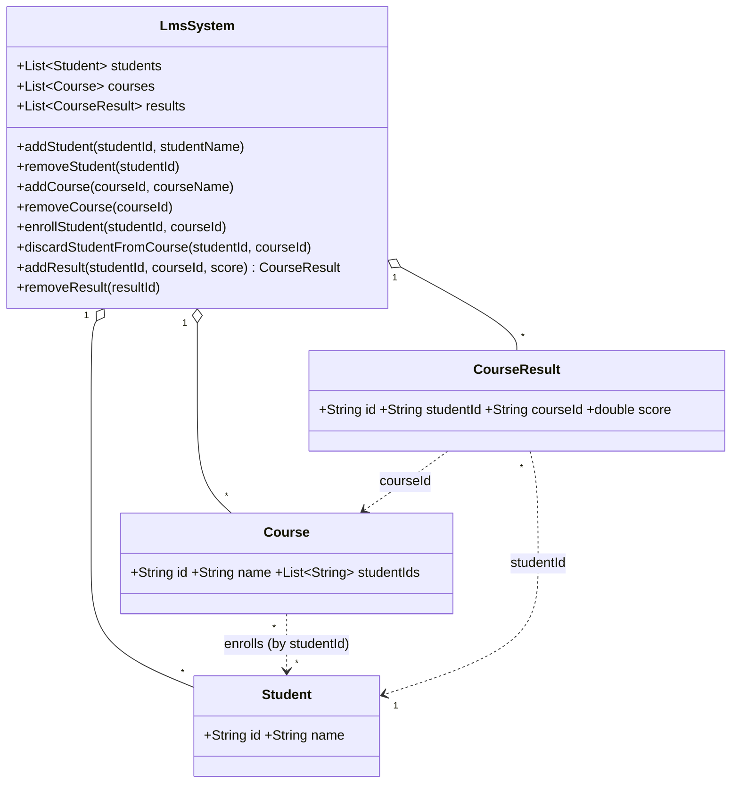

# LMS – Layered Architecture

Three layers: `lib/model` (data), `lib/service` (state + business rules), `test` (service API tests).
No repository layer, no database.

## UML



## Business rules (chosen policies)

| Operation | Rules |
|---|---|
| `addCourse` | Course ID must be unique. |
| `removeCourse` | Course must exist. Its enrollments and all its results are removed; students are kept. |
| `enrollStudent` | Student and course must exist; not already enrolled. |
| `discardStudentFromCourse` | Student and course must exist; student must be enrolled. The student's results in that course are removed. |
| `removeStudent` | Student must exist. Removed from the student list, every course, and all results. |
| `addResult` | Student and course must exist; student must be enrolled; score in 0–100; only one result per student per course. ID auto-generated (`R1`, `R2`, ...). |
| `removeResult` | Result must exist. Student and course are untouched; no enrollment required. |

## Run

```
dart pub get
dart test
```
